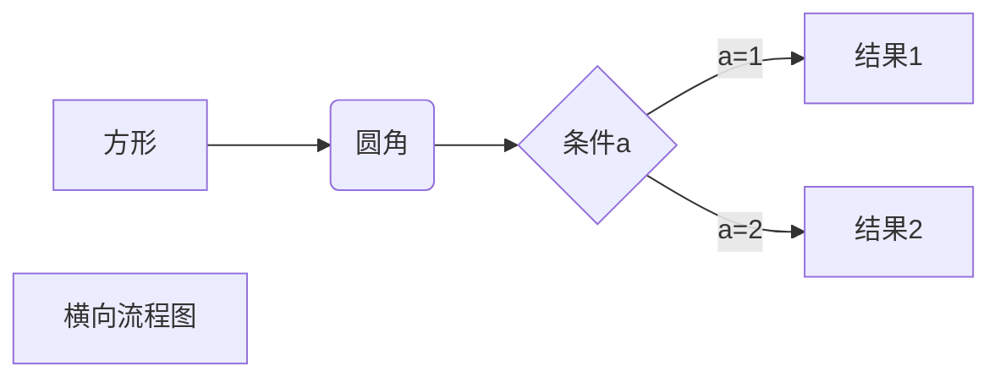
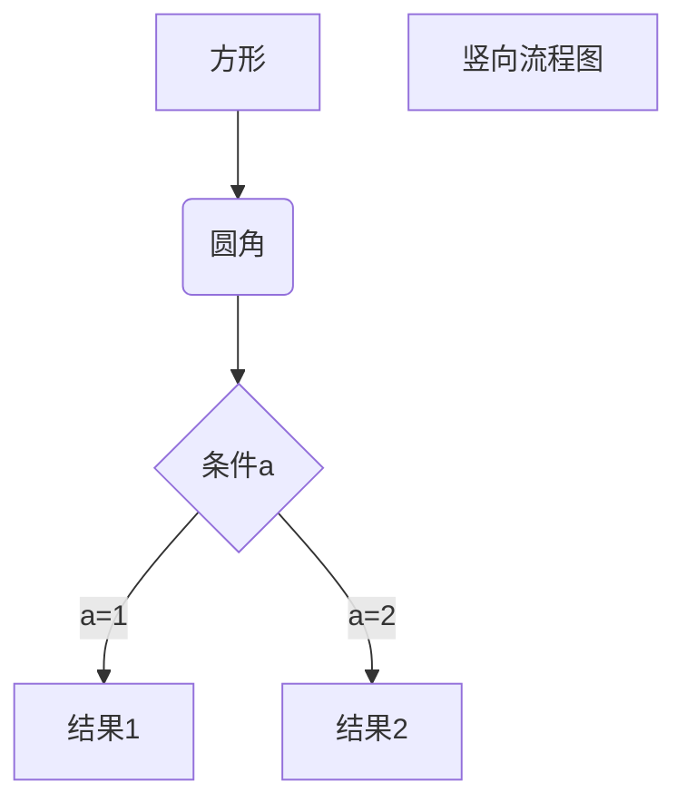
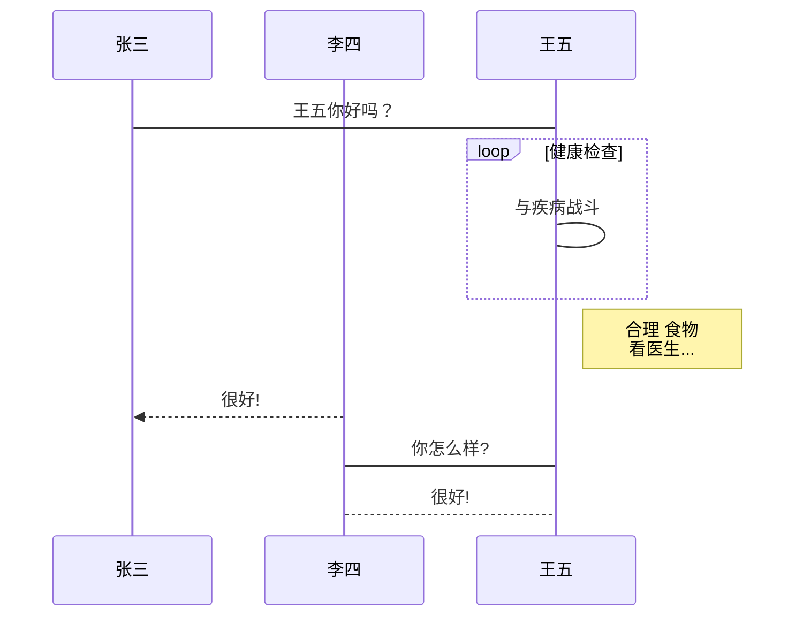
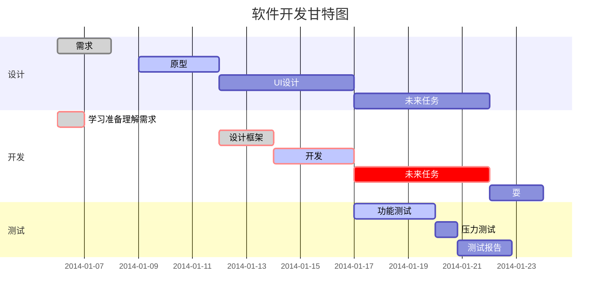

This post is originated from [here](https://gist.github.com/apackeer/4159268) and is used for testing markdown style. This post contains nearly every markdown usage. Make sure all the markdown elements below show up correctly.

<!-- more -->

-------

## Color
```markdown
这是默认颜色的文本，而这是<span style="color: red;">红色</span>的文本。

<span style='color:文字颜色;background:背景颜色;font-size:文字大小;font-family:字体;'>文字</span>

```

这是默认颜色的文本，而这是<span style="color: red;">红色</span>的文本。


## Headers标题字体

```markdown
# H1
## H2
### H3
#### H4
##### H5
###### H6

Alternatively, for H1 and H2, an underline-ish style:

Alt-H1
======

Alt-H2
------
```

# H1
## H2
### H3
#### H4
##### H5
###### H6


Alternatively, for H1 and H2, an underline-ish style:

Alt-H1
======

Alt-H2
------


## Emphasis 强调

```markdown
# 单个 * 或者 下划线 表示*斜体*
Emphasis, aka italics, with *asterisks* or _underscores_.

# 两个 * 或者 下划线 表示**加粗**
Strong emphasis, aka bold, with **asterisks** or __underscores__.

# 也可以结合使用
Combined emphasis with **asterisks and _underscores_**.

# 三个表示粗斜体
***粗斜体文本***
___粗斜体文本___

# 波浪线表示 ~~划去~~
Strikethrough uses two tildes. ~~Scratch this.~~

# 下划线要通过 HTML 的 <u></u> 标签来实现：
<u>这是带下划线的文字示例</u>

```

Emphasis, aka italics, with *asterisks* or _underscores_.

Strong emphasis, aka bold, with **asterisks** or __underscores__.

Combined emphasis with **asterisks and _underscores_**.

Strong emphasis, aka bold italics, with  ***asterisks*** or  ___underscores___.

Strikethrough uses two tildes. ~~Scratch this.~~

<u>This is the eg.</u>
## Lists

```markdown
1. First ordered list item
2. Another item
  * Unordered sub-list.
1. Actual numbers don't matter, just that it's a number
  1. Ordered sub-list
4. And another item.

   You can have properly indented paragraphs within list items. Notice the blank line above, and the leading spaces (at least one, but we'll use three here to also align the raw Markdown).

   To have a line break without a paragraph, you will need to use two trailing spaces.  
   Note that this line is separate, but within the same paragraph.  
   (This is contrary to the typical GFM line break behaviour, where trailing spaces are not required.)

* Unordered list can use asterisks
- Or minuses
+ Or pluses
- Paragraph In unordered list

  For example like this.

Common Paragraph with some text.
And more text.
```

1. First ordered list item
2. Another item
  * Unordered sub-list.
1. Actual numbers don't matter, just that it's a number
  1. Ordered sub-list
4. And another item.

   You can have properly indented paragraphs within list items. Notice the blank line above, and the leading spaces (at least one, but we'll use three here to also align the raw Markdown).

   To have a line break without a paragraph, you will need to use two trailing spaces.  
   Note that this line is separate, but within the same paragraph.  
   (This is contrary to the typical GFM line break behaviour, where trailing spaces are not required.)

* Unordered list can use asterisks
- Or minuses
+ Or pluses
- Paragraph In unordered list

  For example like this.

Common Paragraph with some text.
And more text.

## Inline HTML

```markdown
<p>To reboot your computer, press <kbd>ctrl</kbd>+<kbd>alt</kbd>+<kbd>del</kbd>.</p>
```

<p>To reboot your computer, press <kbd>ctrl</kbd>+<kbd>alt</kbd>+<kbd>del</kbd>.</p>


```markdown
<dl>
    <dt>Definition list</dt>
    <dd>Is something people use sometimes.</dd>

    <dt>Markdown in HTML</dt>
    <dd>Does *not* work **very** well. Use HTML <em>tags</em>.</dd>
</dl>
```


<dl>
    <dt>Definition list</dt>
    <dd>Is something people use sometimes.</dd>

    <dt>Markdown in HTML</dt>
    <dd>Does *not* work **very** well. Use HTML <em>tags</em>.</dd>
</dl>


## Links（（下划线）

```markdown
[I'm an inline-style link](https://www.google.com)

[I'm an inline-style link with title](https://www.google.com "Google's Homepage")

[I'm a reference-style link][Arbitrary case-insensitive reference text]

[I'm a relative reference to a repository file](../blob/master/LICENSE)

[You can use numbers for reference-style link definitions][1]

Or leave it empty and use the [link text itself]

Some text to show that the reference links can follow later.

[arbitrary case-insensitive reference text]: https://hexo.io
[1]: https://hexo.io/docs/
[link text itself]: https://hexo.io/api/
```

[I'm an inline-style link](https://www.google.com)

[I'm an inline-style link with title](https://www.google.com "Google's Homepage")

[I'm a reference-style link][Arbitrary case-insensitive reference text]

[I'm a relative reference to a repository file](../blob/master/LICENSE)

[You can use numbers for reference-style link definitions][1]

Or leave it empty and use the [link text itself]

Some text to show that the reference links can follow later.

[arbitrary case-insensitive reference text]: https://hexo.io
[1]: https://hexo.io/docs/
[link text itself]: https://hexo.io/api/

## Images（图片插入）

```markdown
hover to see the title text:

Inline-style:


Reference-style:
![alt text][logo]

[logo]: https://hexo.io/icon/favicon-196x196.png "Logo Title Text 2"
```

hover to see the title text:

Inline-style:


Reference-style:
![alt text][logo]

[logo]: https://hexo.io/icon/favicon-196x196.png "Logo Title Text 2"

## Code and Syntax Highlighting（代码块高亮）

Inline `code` has `back-ticks around` it.


```javascript
var s = "JavaScript syntax highlighting";
alert(s);
```

```python
s = "Python syntax highlighting"
print s
```

```
No language indicated, so no syntax highlighting.
But let's throw in a <b>tag</b>.
```

## Tables

```markdown
|                |ASCII                          |HTML                         |
|----------------|-------------------------------|-----------------------------|
|Single backticks|`'Isn't this fun?'`            |'Isn't this fun?'            |
|Quotes          |`"Isn't this fun?"`            |"Isn't this fun?"            |
|Dashes          |`-- is en-dash, --- is em-dash`|-- is en-dash, --- is em-dash|
```

|                |ASCII                          |HTML                         |
|----------------|-------------------------------|-----------------------------|
|Single backticks|`'Isn't this fun?'`            |'Isn't this fun?'            |
|Quotes          |`"Isn't this fun?"`            |"Isn't this fun?"            |
|Dashes          |`-- is en-dash, --- is em-dash`|-- is en-dash, --- is em-dash|


Colons can be used to align columns.

```markdown
| Tables        | Are           | Cool  |
| ------------- |:-------------:| -----:|
| col 3 is      | right-aligned |  |
| col 2 is      | centered      |    |
| zebra stripes | are neat      |   
```

| Tables        | Are           | Cool  |
| ------------- |:-------------:| -----:|
| col 3 is      | right-aligned |  |
| col 2 is      | centered      |    |
| zebra stripes | are neat      |     |

The outer pipes (|) are optional, and you don't need to make the raw Markdown line up prettily. You can also use inline Markdown.

```markdown
Markdown | Less | Pretty
--- | --- | ---
*Still* | `renders` | **nicely**
1 | 2 | 3
```

Markdown | Less | Pretty
--- | --- | ---
*Still* | `renders` | **nicely**
1 | 2 | 3

> You can find more information about **LaTeX** mathematical expressions [here](https://math.meta.stackexchange.com/questions/5020/mathjax-basic-tutorial-and-quick-reference).


## Blockquotes

> Blockquotes are very handy in email to emulate reply text.
> This line is part of the same quote.

Quote break.

> This is a very long line that will still be quoted properly when it wraps. Oh boy let's keep writing to make sure this is long enough to actually wrap for everyone. Oh, you can *put* **Markdown** into a blockquote.

## Horizontal Rule 分割线

```markdown
***
---
- - -
* * *
------
______
<hr>
```
<hr>
示例：
***
---
- - -
* * *
------
______
<hr>


Three or more...

```markdown
---

Hyphens

***

Asterisks

___

Underscores
```

---

Hyphens

***

Asterisks

___

Underscores


## Line Breaks

```markdown
Here's a line for us to start with.

This line is separated from the one above by two newlines, so it will be a *separate paragraph*.

This line is also a separate paragraph, but...
This line is only separated by a single newline, so it's a separate line in the *same paragraph*.
```


Here's a line for us to start with.

This line is separated from the one above by two newlines, so it will be a *separate paragraph*.

This line is also a separate paragraph, but...
This line is only separated by a single newline, so it's a separate line in the *same paragraph*.

-----

```markdown
This is a regular paragraph.

<table>
    <tr>
        <td>Foo</td>
    </tr>
</table>

This is another regular paragraph.
```

This is a regular paragraph.

<table>
    <tr>
        <td>Foo</td>
    </tr>
</table>

This is another regular paragraph.

## HTML 标签

```markdowm
<br>      换行
<hr>     分割
使用 <kbd>Ctrl</kbd>+<kbd>C</kbd> 复制, 使用 <kbd>Ctrl</kbd>+<kbd>V</kbd> 粘贴。
```
示例：

换<br>行
 
分<hr>割

使用 <kbd>Ctrl</kbd>+<kbd>C</kbd> 复制, 使用 <kbd>Ctrl</kbd>+<kbd>V</kbd> 粘贴。

## 转义字符

Markdown 使用了很多特殊符号来表示特定的意义，如果需要显示特定的符号则需要使用转义字符，Markdown 使用反斜杠转义特殊字符。
```markdown
**两个星号是加粗文本** 
\*\* 使用转义字符后正常显示星号 \*\*
```
示例：
**两个星号是加粗文本** 
\*\* 使用转义字符后正常显示星号 \*\*

Markdown 支持以下这些符号前面加上反斜杠来帮助插入普通的符号：
```markdown
\   反斜线
`   反引号
*   星号
_   下划线
{}  花括号
[]  方括号
()  小括号
#   井字号
+   加号
-   减号
.   英文句点
!   感叹号
```

## 公式

**Markdown Preview Enhanced** 使用` KaTeX` 或者` MathJax`来渲染数学表达式。
KaTeX 拥有比 MathJax 更快的性能，但是它却少了很多 MathJax 拥有的特性。你可以查看 KaTeX supported functions/symbols 来了解 KaTeX 支持那些符号和函数。默认下的分隔符：

`$...$` 或者 `\(...\)` 中的数学表达式将会在行内显示。
`$$...$$` 或者 `\[...\]` 或者 ` ``` `math 中的数学表达式将会在块内显示。

示例代码:
```
$ f(x) = sin(x) + 12 $

$$ \sum_{n=1}^{100} n $$


$$
\begin{Bmatrix}
   a & b \\
   c & d
\end{Bmatrix}
$$


$$
\begin{CD}
   A @>a>> B \\
@VbVV @AAcA \\
   C @= D
\end{CD}
$$
```
显示效果:
$$ f(x) = sin(x) + 12 $$
 
$$ \sum_{n=1}^{100} n $$

$$
\begin{Bmatrix}
   a & b \\
   c & d
\end{Bmatrix}
$$
$$
\begin{CD}
   A @>a>> B \\
@VbVV @AAcA \\
   C @= D
\end{CD}
$$

## sup & sub | 上标 & 下标
#### 用法：
```
上标：<sup>内容</sup>
下标：<sub>内容</sub>
```
#### 示例：
mm<sup>2</sup>
平方毫米: mm2

y = log<sub>2 </sub>x
对数: y = log2 x

## div - - align | 各种对齐

#### 用法
```css
<div align="center">奇怪的知识增加了！</div>

<div align="center"><span style='color:white;background:black;font-size:20px;'>&#12288“事情总会朝着意想不到的方向发展”&#12288</span></div>
```
#### 示例：
<div align="center">奇怪的知识增加了！</div>
<div align="center"><span style='color:white;background:black;font-size:20px;'>&#12288“事情总会朝着意想不到的方向发展”&#12288</span></div>
　
|   参数    |   功能    |
| :-----: | :-----: |
|  left   |   左对齐   |
|  right  |   右对齐   |
| center  |  居中对齐   |
| justify | 伸展行文字间隔 |
## 其它语法格式

1. **横向流程图格式**：
```markdown
```mermaid
graph LR
A[方形] -->B(圆角)
    B --> C{条件a}
    C -->|a=1| D[结果1]
    C -->|a=2| E[结果2]
    F[横向流程图]
```                          # end
```
显示效果


**竖向流程图格式**：
```markdown

```mermaid
graph TD
A[方形] --> B(圆角)
    B --> C{条件a}
    C --> |a=1| D[结果1]
    C --> |a=2| E[结果2]
    F[竖向流程图]
```                           # end
```
显示效果


**UML标准时序图样例**：
```markdown
```mermaid
%% 时序图例子,-> 直线，-->虚线，->>实线箭头
  sequenceDiagram
    participant 张三
    participant 李四
    张三->王五: 王五你好吗？
    loop 健康检查
        王五->王五: 与疾病战斗
    end
    Note right of 王五: 合理 食物 <br/>看医生...
    李四-->>张三: 很好!
    王五->李四: 你怎么样?
    李四-->王五: 很好!
```                           # end
```
显示效果


**甘特图样例**：
```markdown
```mermaid
%% 语法示例
        gantt
        dateFormat  YYYY-MM-DD
        title 软件开发甘特图
        section 设计
        需求                      :done,    des1, 2014-01-06,2014-01-08
        原型                      :active,  des2, 2014-01-09, 3d
        UI设计                     :         des3, after des2, 5d
    未来任务                     :         des4, after des3, 5d
        section 开发
        学习准备理解需求                      :crit, done, 2014-01-06,24h
        设计框架                             :crit, done, after des2, 2d
        开发                                 :crit, active, 3d
        未来任务                              :crit, 5d
        耍                                   :2d
        section 测试
        功能测试                              :active, a1, after des3, 3d
        压力测试                               :after a1  , 20h
        测试报告                               : 48h
```                           # end
```
显示效果：


## 注脚

```markdown
使用 [^keyword] 表示注脚。
```
示例：

我是主体[^我是注脚] 

## 列表

Markdown 支持有序列表和无序列表。

**无序列表**
格式：
无序列表使用星号(*)、加号(+)或是减号(-)作为列表标记，这些标记后面要添加一个空格，然后再填写内容：
```markdown
* aa
* bb

+ aa
+ bb

- aa
- bb
```

**有序列表**
格式：
使用数字并加上 . 号来表示：1+.+空格
```
1. aa
2. bb
```
示例：
1. aa
2. bb

**列表嵌套**
格式：
列表嵌套只需在子列表中的选项前面添加四个空格即可：
```
1. aa
    - bb
2. cc
    - dd
```
1. aa
	- bb


## 图片

Markdown图片语法格式是: ` `或 ``
示例代码：
```


```
显示效果:


## Youtube videos

```markdown
<a href="https://www.youtube.com/watch?feature=player_embedded&v=ARted4RniaU
" target="_blank"></a>

Pure markdown version:

[](https://www.youtube.com/watch?v=ARted4RniaU)
```

<a href="https://www.youtube.com/watch?feature=player_embedded&v=ARted4RniaU
" target="_blank"></a>

## HEXO 专有

#### TAB页
```

<!-- tab `tabname` @fab fa-github-square -->
内容1
<!-- endtab -->

<!-- tab `tabname` -->
内容2
<!-- endtab -->

```
效果如下：

<!-- tab `tabname1` @fab fa-github-square -->
内容1
<!-- endtab -->

<!-- tab `tabname2` -->
内容2
<!-- endtab -->



#### NOTES

```

text.....

```
效果如下：

升級方法：在 Hexo 根目錄下，運行 `npm update hexo-theme-butterfly`


```
> **注意：**  text....
```
效果如下：
> **注意：** 不要把主題目錄的 `_config.yml` 刪掉
#### 推荐阅读
```

```
效果如下：

